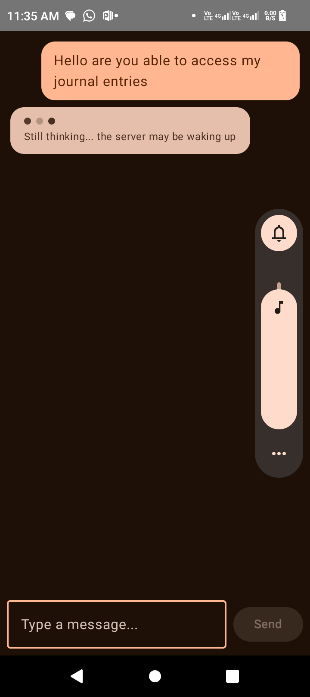
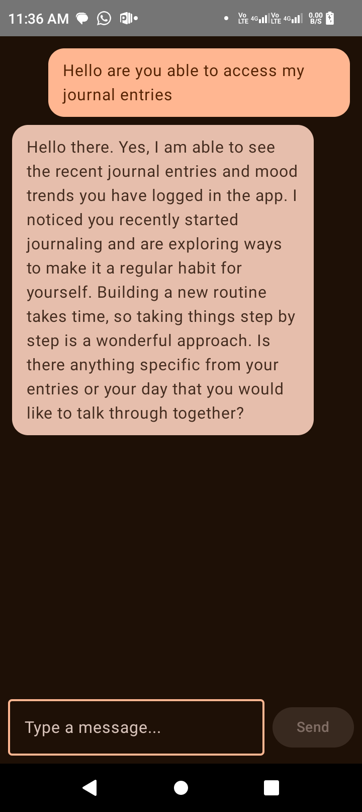
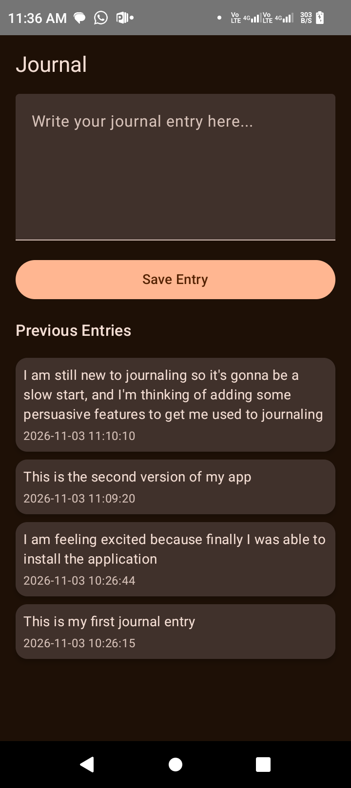
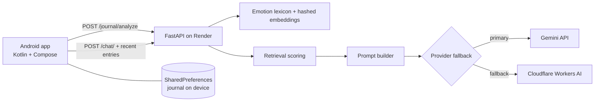

# Khula

An Android journal and emotional-support chat app with a FastAPI backend. Journal entries are stored on the device. The backend analyzes each entry for emotion and a text embedding, then uses those to retrieve relevant past entries when you chat, so the chatbot can respond with context from your own journal.

> **Status:** personal portfolio project. It is not a medical or mental-health product and is not a substitute for professional help.

[Screenshot or demo GIF here]  

## Architecture



## How it works

1. **Save an entry.** The text is written to local storage immediately. The app then calls `POST /journal/analyze`, which returns emotion labels and a 256-dimensional embedding that are stored with the entry. If the backend is unreachable, the entry is still saved and the screen shows the failure.
2. **Chat.** The app sends your message, up to 100 recent entries that have embeddings, and a seven-day mood summary to `POST /chat/`.
3. **Retrieve.** The backend scores each entry and keeps up to three excerpts:
   - cosine similarity of embeddings: 60%
   - recency (30-day decay): 25%
   - emotion-label overlap: 15%
4. **Generate.** The mood trend, retrieved excerpts, and your message go into a prompt with supportive-response and safety guidance. The backend tries Gemini first and falls back to Cloudflare Workers AI if Gemini fails.

## Design decisions

- **Local-first storage.** Journal text stays on the device and a backend outage never loses an entry.
- **Provider fallback.** A shared request helper uses bounded retries with exponential backoff. Provider name, success or failure, and elapsed time are logged, and prompts and journal text are never logged.
- **Free-tier hosting.** The backend loads no large ML models, so it fits Render's free tier.
- **Hybrid retrieval.** Similarity, recency, and emotion overlap combine into a transparent score rather than similarity alone.
- **Prompt-injection awareness.** Retrieved journal text is labeled as untrusted context in the prompt.

## Known limitations

These are real and I would rather state them than have them discovered.

- **Embeddings are lexical, not semantic.** They are hashed word and adjacent-word features, so they reward shared wording and do not understand meaning. "Worried" will not match "anxious". Replacing them with a real embedding model is the main planned improvement.
- **Emotion detection is a keyword lexicon.** It uses GoEmotions-style label names, but it is not the GoEmotions model, and it is often wrong. A message about wanting more trust at work was labeled "desire".
- **No authentication or rate limiting.** The API is public, so anyone with the URL can use the provider quota. Planned: token verification, rate limits, and request-size caps.
- **No pre-call crisis detection.** Crisis handling currently depends on prompt instructions only. Planned: a keyword and pattern check that returns crisis resources before any model call, with tests.
- **Local storage is not encrypted, and there is no delete-all feature.**
- **Privacy.** Journal text is sent to the backend, and selected excerpts and your message are sent to Gemini or Cloudflare. Do not enter anything you would not want processed by those services. The app makes no confidentiality promises.
- **Cold starts.** Render's free tier sleeps when idle, so the first request can take up to a minute. The app shows a "still thinking" hint after 8 seconds and uses long network timeouts.
- **Free-tier quotas and model names change.** See "Troubleshooting".

## Evaluation

Current automated tests check retrieval mechanics (ranking, recency, emotion overlap, exclusion of entries without embeddings) and provider retry and fallback logic. They use synthetic data and mocked providers, so they verify control flow, not real-world retrieval quality or live provider availability.

## Backend setup

Python 3.10 or newer.

```bash
python -m venv .venv
source .venv/bin/activate
pip install -r requirements.txt
cp .env.example .env
# Edit .env locally. Never commit it or paste keys into chat.
uvicorn app:app --host 0.0.0.0 --port 8000
```

Interactive API docs are at `/docs`.

### Environment variables

| Variable | Required | Purpose |
|---|---|---|
| `GEMINI_API_KEY` | One provider needed | Primary chat provider |
| `GEMINI_MODEL` | No | Gemini model name. Set this if the default is retired |
| `CLOUDFLARE_ACCOUNT_ID` | For fallback | Cloudflare account |
| `CLOUDFLARE_API_TOKEN` | For fallback | Token with Workers AI permission only |
| `CLOUDFLARE_AI_MODEL` | No | Fallback model name |

Free-tier availability, quotas, and model names change often. Check each provider's current documentation.

## Deploy to Render

`render.yaml` defines a free Python web service.

1. Push the repository to GitHub.
2. In Render, choose **New, then Blueprint**, connect the repo, and deploy.
3. Enter `GEMINI_API_KEY` when prompted.
4. Open **Environment** for the service and add `CLOUDFLARE_ACCOUNT_ID`, `CLOUDFLARE_API_TOKEN`, and optionally `GEMINI_MODEL`. Blueprints only prompt for variables declared in `render.yaml`.
5. Check that the service root URL returns the JSON welcome message.

## Build and install the Android app

Requirements: JDK 21 and Android SDK Platform 35 with build tools.

```bash
bash ./gradlew assembleDebug -PbackendBaseUrl=https://YOUR-SERVICE.onrender.com/
```

Include the trailing slash. The APK is written to `app/build/outputs/apk/debug/app-debug.apk`.

- **Emulator:** use `http://10.0.2.2:8000/` for a local backend.
- **Physical phone:** use a backend reachable from the phone, such as your Render URL. `10.0.2.2` only works inside an emulator.
- **Building in GitHub Codespaces:** Codespaces cannot reach a USB-connected phone. Download the APK and install it from Google Drive or another file source.
- Updating over an existing install requires the same package name and signing key. Uninstalling the app deletes its local journal data.

Provider keys stay on the backend and are never included in the APK.

## Tests

```bash
python -m unittest discover -v
bash ./gradlew testDebugUnitTest
```

## Troubleshooting

- **Chat times out on the phone.** Check the Render logs for `Provider=...` lines to see which provider answered and how long it took. Confirm the app's HTTP read timeout is longer than Render's cold start.
- **Gemini returns 404.** The configured model has been retired or renamed. Set `GEMINI_MODEL` to a current model name from Google's documentation.
- **Replies cut off mid-sentence.** The output token limit is too low for models that use tokens on internal reasoning. Raise `maxOutputTokens` for Gemini and `max_tokens` for Cloudflare.
- **Debugging story.** Chat requests were timing out because the app's default 10-second timeout was shorter than the backend's work: a Render cold start plus a failing Gemini call, with fallback to Cloudflare hiding the primary failure. Per-provider logging exposed the 404, and the fix combined a new model name with longer, explicit client timeouts.

## Roadmap

- [ ] Real semantic embeddings, compared against the hashed baseline
- [ ] Labeled retrieval benchmark (Recall@k, MRR)
- [ ] Pre-call crisis detection with tests
- [ ] API authentication, rate limiting, and request-size limits
- [ ] GitHub Actions workflow to run tests on every push
- [ ] Persist chat history; encrypted local storage; delete-all feature